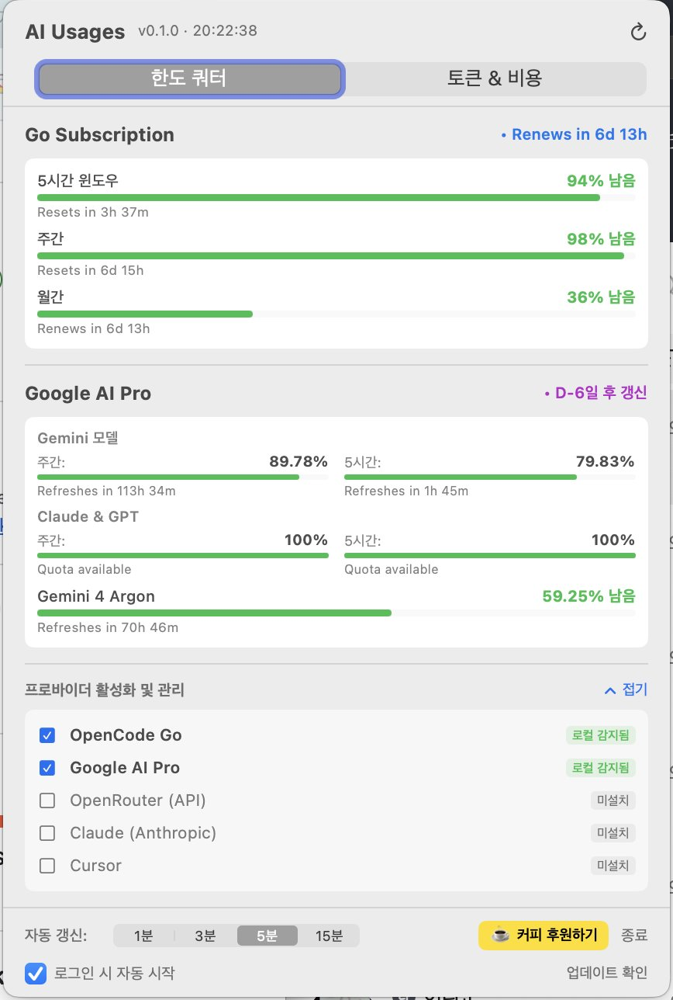

# AI Usages

A featherweight, native **macOS menu bar utility** for monitoring real-time quotas, token spend, and subscription renewal countdowns for **OpenCode Go**, **Google AI Pro** (Gemini Models, Claude & GPT, Gemini 4 Argon), and **OpenRouter**.

[](https://www.swift.org)
[](https://www.apple.com/macos)
[](#)
[](LICENSE)
[](https://buymeacoffee.com/dwyi84d)

---

<p align="center">
  
</p>

---

## Highlights

- **Adaptive Vertical Segmented Gauges** — borderless, razor-sharp Retina segmented bars in your menu bar. Dynamically renders 1, 2, or 3 bars according to your active providers. Color automatically shifts from vibrant battery green to amber (≤35%) and critical red (≤15%).
- **Dual Dashboard Modes** — seamlessly toggle between **Quotas (한도 쿼터)** for subscription models (OpenCode Go, Google AI Pro) and **Tokens & Cost (토큰 & 비용)** for pay-as-you-go APIs (OpenRouter balance, today/month spend, token volume).
- **Hybrid Provider Management** — auto-detects locally installed developer tools (OpenCode SQLite DB, Antigravity CLI) with clear badges, placing active providers on top with easy checkbox controls.
- **Lightweight High-Speed REST Engine** — queries Google Cloud Code and OpenCode endpoints directly via sub-second REST API calls (0.2s) with automatic CLI fallback, saving CPU and battery.
- **Safe Rate-Limit Resilient Polling** — configurable intervals (1m, 3m, 5m default, 15m) with automatic exponential backoff on HTTP 429 and stale-while-revalidate caching.
- **Dynamic Renewal & Refresh Timers** — live countdowns for 5-hour rolling windows, weekly quotas, and monthly billing subscription renew dates (`Refreshes in Xh Ym` / `Renews in Xd Yh`).
- **Clean In-Menu Controls** — one-click **Launch at Login**, inline **Check for Updates**, and Buy Me a Coffee support. No separate preference windows, no clutter.
- **Bilingual Localization** — seamlessly adapts between English and Korean based on your macOS system language preferences.

---

## Requirements

- macOS 13 (Ventura) or later
- Apple Silicon (arm64)
- OpenCode CLI and/or Antigravity CLI logged in (or OpenRouter API key)

---

## Installation

### Homebrew (recommended)

```bash
brew install --cask dwyi84/tap/aiusages
```

This installs **AI Usages.app** to `/Applications`. Because the app is signed with an ad-hoc local certificate, Gatekeeper may prompt on first launch — right-click **AI Usages.app** and choose **Open**, or run:

```bash
xattr -dr com.apple.quarantine "/Applications/AI Usages.app"
```

### Manual Download

1. Download the latest `AIUsages-<version>.zip` from [Releases](https://github.com/dwyi84/usages/releases).
2. Unzip and drag `AI Usages.app` into `/Applications`.
3. Launch the app from Spotlight or Launchpad.

### Build from Source

```bash
git clone https://github.com/dwyi84/usages.git
cd usages
make install
```

---

## Privacy & Security

AI Usages runs completely on your local machine:
- **No Telemetry & No Tracking:** Zero analytics or tracking libraries.
- **No Cloud Upload of Credentials:** Local session tokens and CLI engines are read locally and only used to query the official endpoints (`https://opencode.ai/zen/go/v1/usage`, Google's code assist prediction service, and OpenRouter).
- **Network Requests:** Only queries your own quota status and optional GitHub Releases version checks.

---

## License

Released under the [MIT License](LICENSE).

---

## Support

If AI Usages helps you keep track of your AI quotas at a glance, consider buying me a coffee — it keeps the meters glowing! ☕

[](https://buymeacoffee.com/dwyi84d)

<p align="center">Crafted by MelissaSoft · Made with ❤️ on Apple Silicon.</p>
<p align="center">Copyright © 2026 Dawoon Yi / MelissaSoft</p>
